# LAB03 — Báo cáo mô tả hệ thống phân cụm khách hàng (Customer Segmentation)

## 1. Mục tiêu

Xây dựng chương trình phân cụm khách hàng bằng thuật toán K-Means thuộc
nhóm học máy không giám sát (*Unsupervised Learning*).

Mục tiêu của bài thực hành: - Khám phá dữ liệu khách hàng và phân tích
đặc điểm của các biến. - Làm sạch dữ liệu, lựa chọn đặc trưng và chuẩn
hóa dữ liệu. - Tự cài đặt thuật toán K-Means bằng NumPy, không sử dụng
`sklearn.cluster.KMeans`. - Thử nghiệm nhiều giá trị K để lựa chọn số
cụm phù hợp. - Đánh giá kết quả bằng Inertia, Silhouette Score và các
chỉ số bổ sung. - Phân tích hồ sơ từng cụm để hiểu đặc điểm của các nhóm
khách hàng. - Thực hiện dự đoán cụm cho khách hàng mới bằng mô hình đã
huấn luyện. - Theo dõi tiến trình, lưu nhật ký và tự động tổng hợp báo
cáo sau mỗi lần chạy Pipeline.

Không giống bài toán phân loại có nhãn đúng/sai, K-Means tìm cấu trúc
nhóm dựa trên khoảng cách giữa các điểm dữ liệu. Vì vậy, kết quả cần
được đánh giá kết hợp bằng chỉ số định lượng, biểu đồ và ý nghĩa của
từng cụm.

## 2. Cấu trúc và thành phần

  --------------------------------------------------------------------------
  Thành phần                             Vai trò
  -------------------------------------- -----------------------------------
  `data/raw/customer_segmentation.csv`   Dữ liệu khách hàng ban đầu

  `src/eda.py`                           Khám phá dữ liệu, thống kê và trực
                                         quan hóa

  `src/preprocess.py`                    Làm sạch dữ liệu, chọn đặc trưng và
                                         chuẩn hóa Z-score

  `src/models/kmeans.py`                 Cài đặt thuật toán K-Means bằng
                                         NumPy

  `src/train.py`                         Thử nghiệm K từ 2 đến 8, chọn mô
                                         hình và lưu kết quả

  `src/evaluate.py`                      Gán nhãn cụm, đánh giá và tạo hồ sơ
                                         cụm

  `src/experiments.py`                   So sánh feature spaces và thực hiện
                                         Grid Search

  `src/demo_convergence.py`              Theo dõi và trực quan hóa quá trình
                                         hội tụ

  `src/predict.py`                       Dự đoán cụm cho khách hàng mới và
                                         lưu lịch sử

  `src/tracking.py`                      Quản lý Run_ID, tiến trình JSON và
                                         nhật ký

  `src/figure_manager.py`                Thu thập, phân loại hình ảnh theo
                                         Run_ID và Stage

  `src/report.py`                        Tổng hợp dữ liệu và xuất báo cáo
                                         MD, HTML, PDF

  `src/pipeline.py`                      Điều phối các giai đoạn của toàn bộ
                                         quy trình

  `config.yaml`                          Lưu cấu hình dữ liệu, K và các
                                         thiết lập thực nghiệm mở rộng

  `notebooks/`                           Notebook trình bày quá trình thực
                                         nghiệm

  `app.py`                               Giao diện Streamlit để nhập thông
                                         tin và dự đoán cụm

  `tests/`                               Kiểm thử các thành phần của dự án

  `docs/`                                Lưu tài liệu, lịch sử thực nghiệm
                                         và hình ảnh

  `data/processed/`                      Lưu dữ liệu sau tiền xử lý và kết
                                         quả

  `models/`                              Lưu mô hình K-Means đã huấn luyện

  `progress_results/`, `logs/`           Lưu tiến trình và nhật ký thực thi

  `reports/`                             Lưu báo cáo, hình ảnh tổng hợp và
                                         lịch sử inference
  --------------------------------------------------------------------------

## 3. Dữ liệu

### 3.1. Mô tả dữ liệu

Dữ liệu được lưu tại `data/raw/customer_segmentation.csv`, gồm 15.079
bản ghi và 5 cột:

  -----------------------------------------------------------------------
  Đặc trưng               Ý nghĩa                 Vai trò
  ----------------------- ----------------------- -----------------------
  `Customer ID`           Mã định danh khách hàng Chỉ dùng nhận diện,
                                                  không đưa vào mô hình

  `Age`                   Tuổi khách hàng         Đặc trưng phân cụm

  `Gender`                Giới tính               Dùng mô tả đặc điểm cụm

  `Annual Income`         Thu nhập hằng năm       Đặc trưng phân cụm

  `Spending Score`        Điểm chi tiêu           Đặc trưng phân cụm
  -----------------------------------------------------------------------

Ba đặc trưng cơ sở được sử dụng để tính khoảng cách là: - `Age` -
`Annual Income` - `Spending Score`

`Customer ID` không mang ý nghĩa khoảng cách và không được đưa vào mô
hình. `Gender` là biến phân loại, được giữ lại để mô tả tỷ lệ giới tính
trong từng cụm; không đưa vào feature space cơ sở.

### 3.2. Khám phá dữ liệu (EDA)

**Biểu đồ khám phá dữ liệu (EDA)**

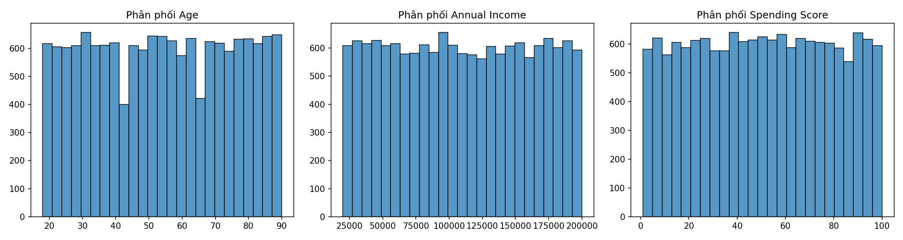

*Hình 1. Phân phối của Age, Annual Income và Spending Score.*

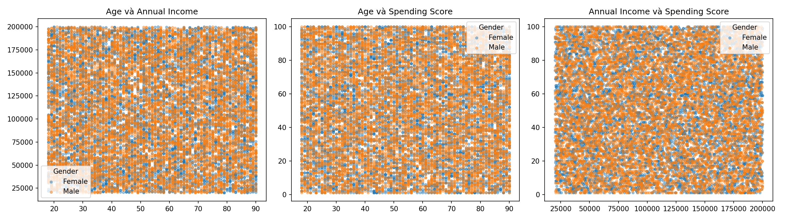

*Hình 2. Mối quan hệ giữa các đặc trưng số.*

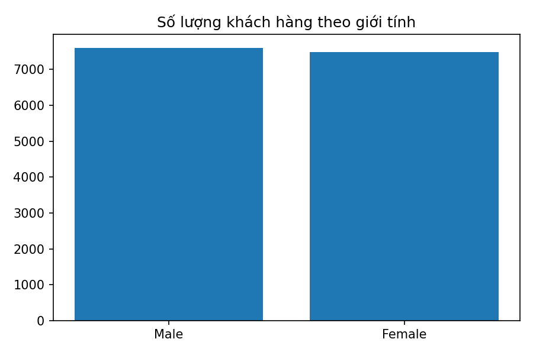

*Hình 3. Phân bố giới tính trong tập dữ liệu.*

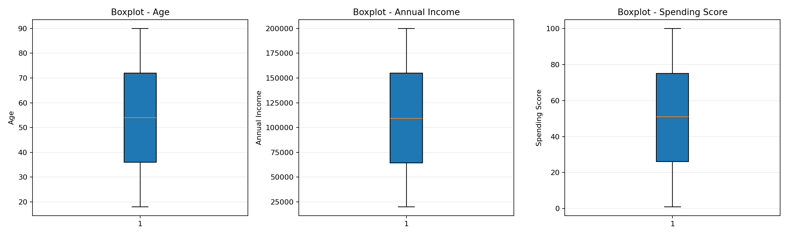

*Hình 4. Phân tích ngoại lệ bằng IQR.*


Chương trình `src/eda.py` thực hiện: - Kiểm tra kích thước dữ liệu và
kiểu dữ liệu. - Kiểm tra giá trị thiếu và dòng trùng lặp. - Tính thống
kê mô tả cho các biến. - Khảo sát phân phối của tuổi, thu nhập và điểm
chi tiêu. - Trực quan hóa quan hệ giữa các đặc trưng bằng biểu đồ phân
tán. - Phát hiện và thống kê ngoại lệ theo quy tắc IQR. - Sử dụng
boxplot để quan sát các giá trị ngoại lệ.

Ngoại lệ được thống kê và trực quan hóa, không tự động xóa chỉ vì nằm
ngoài ngưỡng IQR. Giá trị cực đoan có thể là quan sát hợp lệ và có ý
nghĩa trong hành vi khách hàng.

## 4. Luồng xử lý hệ thống

Quy trình chính của Lab03:

``` text
customer_segmentation.csv
          |
          v
Exploratory Data Analysis (EDA)
- Kiểm tra dữ liệu
- Thống kê mô tả
- Phân phối và ngoại lệ
          |
          v
Preprocessing
- Loại dòng trùng
- Chuyển kiểu dữ liệu
- Xử lý thiếu / không hữu hạn
          |
          v
Feature Selection
- Age
- Annual Income
- Spending Score
          |
          v
Standardization (Z-score)
          |
          v
X_scaled.csv
          |
          v
Training: K-Means với K = 2..8
          |
          v
Đánh giá Inertia và Silhouette Score
          |
          v
Chọn K có Silhouette Score cao nhất
          |
          v
Lưu best_kmeans.pkl
          |
          v
Evaluation
- Gán Cluster cho khách hàng
- Tạo cluster profile
- Tạo biểu đồ và results_summary.md
          |
          v
Visualization Management
- Thu thập hình ảnh theo Run_ID
          |
          v
Report Generation
- Markdown
- HTML
- PDF
          |
          v
Inference
- Nhập khách hàng mới
- Chuẩn hóa bằng scaler đã lưu
- Dự đoán Cluster
- Lưu inference_history.csv
```

Pipeline cơ bản điều phối EDA, Preprocessing, Training, Evaluation,
Visualization và Report. Khi sử dụng tùy chọn `--extended`, Pipeline
chạy thêm Experiments và Convergence. Inference là luồng sử dụng mô hình
sau huấn luyện, có thể chạy độc lập.

### 4.1. Làm sạch dữ liệu

Trong `src/preprocess.py`, hàm `clean_data()` xử lý dữ liệu đầu vào: 1.
Tạo bản sao dữ liệu để không thay đổi trực tiếp DataFrame ban đầu. 2.
Loại bỏ các dòng trùng lặp hoàn toàn. 3. Chuyển các đặc trưng số về kiểu
numeric. 4. Loại bỏ dòng thiếu các giá trị cần thiết. 5. Loại bỏ các
dòng có giá trị không hữu hạn. 6. Giữ lại các cột cần thiết cho phân
tích và mô hình.

Chương trình kiểm tra các cột bắt buộc gồm `Customer ID`, `Age`,
`Gender`, `Annual Income`, `Spending Score`. Các đặc trưng dùng để huấn
luyện là ba biến số đã xác định, không phải toàn bộ năm cột.

### 4.2. Chuẩn hóa dữ liệu

**Kết quả tiền xử lý và chuẩn hóa**

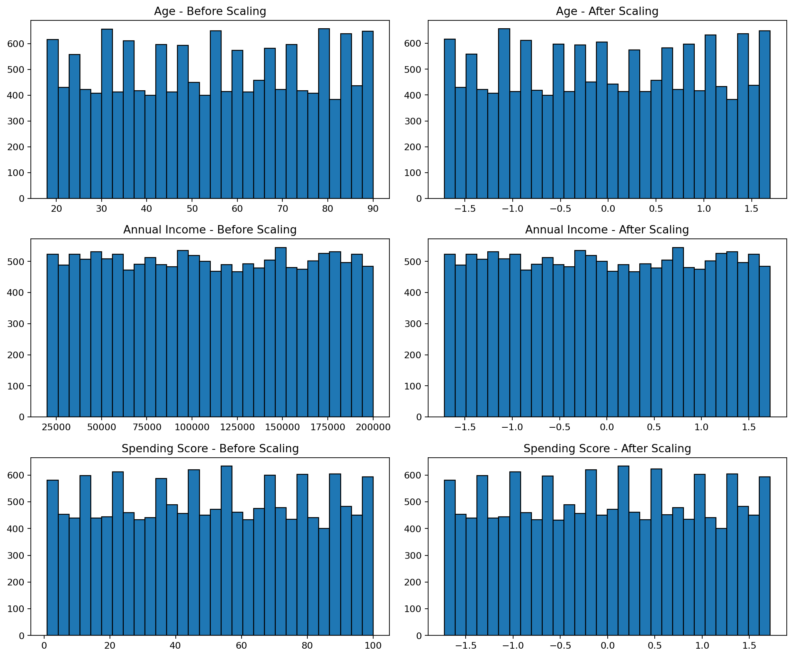

*Hình 5. So sánh thang đo đặc trưng trước và sau chuẩn hóa Z-score.*

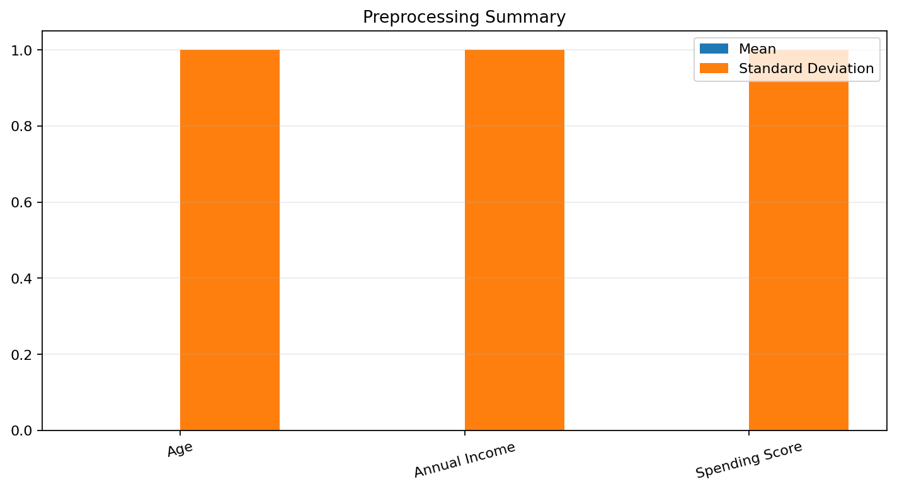

*Hình 6. Tổng quan kết quả làm sạch và chuẩn hóa dữ liệu.*


K-Means dựa trên khoảng cách Euclidean. Nếu các đặc trưng có đơn vị hoặc
độ lớn khác nhau, biến có giá trị số lớn có thể chi phối khoảng cách. Vì
vậy, dự án sử dụng chuẩn hóa Z-score:

\[ z = `\frac{x-\mu}{\sigma}`{=tex} \]

Trong đó: - (x): giá trị ban đầu. - (`\mu`{=tex}): giá trị trung bình
của đặc trưng. - (`\sigma`{=tex}): độ lệch chuẩn của đặc trưng. - (z):
giá trị sau chuẩn hóa.

Hàm `standardize_features()` trong `src/preprocess.py` tính mean và
standard deviation trên dữ liệu, sau đó chuẩn hóa ba đặc trưng. Nếu độ
lệch chuẩn bằng 0, chương trình dùng giá trị thay thế an toàn để tránh
phép chia cho 0.

Các thông tin chuẩn hóa được lưu để sử dụng lại khi dự đoán khách hàng
mới. Những tệp đầu ra chính: - `data/processed/customers_clean.csv` -
`data/processed/X_scaled.csv` - `data/processed/scaler.json` -
`data/processed/outlier_summary.csv` (nếu được tạo trong bước phân tích
ngoại lệ)

Không chia Train/Test theo cách học có giám sát vì đây là bài toán phân
cụm khám phá, không có nhãn mục tiêu để huấn luyện và kiểm tra như bài
toán phân loại.

## 5. Phương pháp K-Means

### 5.1. Nguyên lý thuật toán

K-Means chia dữ liệu thành K cụm. Mỗi cụm được đại diện bởi một tâm cụm
(*centroid*). Mục tiêu là gán mỗi điểm dữ liệu vào tâm gần nhất và cập
nhật tâm sao cho tổng bình phương khoảng cách trong cụm nhỏ.

Với điểm dữ liệu (x_i) và tâm cụm (`\mu`{=tex}\_j), khoảng cách
Euclidean:

\[
d(x_i,`\mu`{=tex}\_j)=`\sqrt{\sum_{m=1}^{p}(x_{im}-\mu_{jm})^2}`{=tex}
\]

Hàm mục tiêu Inertia:

\[
J=`\sum`{=tex}*{j=1}\^{K}`\sum`{=tex}*{x_i`\in `{=tex}C_j}\|x_i-`\mu`{=tex}\_j\|\^2
\]

Trong đó: - (K): số cụm. - (C_j): tập điểm thuộc cụm j. -
(`\mu`{=tex}\_j): tâm của cụm j. - (J): tổng bình phương khoảng cách từ
điểm dữ liệu đến tâm cụm tương ứng.

K-Means luân phiên hai bước: 1. **Assignment:** tính khoảng cách từ mỗi
điểm đến các tâm và gán điểm vào cụm có tâm gần nhất. 2. **Update:**
tính trung bình các điểm trong từng cụm để cập nhật tâm cụm.

Hai bước được lặp lại cho đến khi tâm cụm thay đổi rất nhỏ hoặc đạt số
vòng lặp tối đa.

### 5.2. Cài đặt trong `src/models/kmeans.py`

Dự án tự cài đặt lớp `KMeans` bằng NumPy. Các thành phần quan trọng:

  -----------------------------------------------------------------------
  Thành phần                          Chức năng
  ----------------------------------- -----------------------------------
  `__init__()`                        Khởi tạo K, max_iter, init, tol và
                                      random_state

  `_squared_distances()`              Tính bình phương khoảng cách giữa
                                      điểm và tâm

  `_initialize_centers()`             Khởi tạo tâm theo Random hoặc
                                      K-means++

  `fit()`                             Huấn luyện K-Means qua Assignment
                                      và Update

  `predict()`                         Gán cụm cho dữ liệu mới dựa trên
                                      tâm đã học

  `centers_`                          Lưu tọa độ các tâm cụm

  `labels_`                           Lưu nhãn cụm của dữ liệu huấn luyện

  `inertia_`                          Lưu tổng bình phương khoảng cách
                                      trong cụm

  `n_iter_`                           Số vòng lặp thực tế

  `history_`                          Lịch sử Inertia, độ dịch chuyển tâm
                                      và kích thước cụm
  -----------------------------------------------------------------------

### 5.3. Khởi tạo tâm bằng K-means++

K-means++ chọn tâm ban đầu có chủ đích để hạn chế việc các tâm nằm quá
gần nhau: 1. Chọn ngẫu nhiên một điểm làm tâm đầu tiên. 2. Tính bình
phương khoảng cách từ mỗi điểm đến tâm gần nhất đã chọn. 3. Chọn tâm
tiếp theo với xác suất tỷ lệ với bình phương khoảng cách đó. 4. Lặp đến
khi có đủ K tâm.

Ngoài K-means++, mã nguồn còn hỗ trợ `init="random"` để chọn ngẫu nhiên
K điểm khác nhau làm tâm ban đầu. `random_state` giúp tái lập quá trình
khởi tạo.

### 5.4. Xử lý cụm rỗng

Trong quá trình cập nhật, có thể xuất hiện cụm không có điểm nào được
gán. Khi đó, mã nguồn chọn điểm đang xa tâm gần nhất nhất để khởi tạo
lại tâm của cụm rỗng. Cách xử lý này giúp tránh phép tính trung bình
trên một cụm không có thành viên.

### 5.5. Điều kiện dừng

Sau mỗi vòng lặp, chương trình tính độ dịch chuyển của các tâm:

\[ shift=\|C\_{new}-C\_{old}\|\_F \]

Nếu `shift <= tol`, thuật toán dừng. Nếu chưa đạt điều kiện, thuật toán
tiếp tục cho đến `max_iter`.

Cấu hình huấn luyện chính trong lần chạy cơ sở: - `K`: lần lượt từ 2 đến
8. - `max_iter=60`. - `init="k-means++"` theo mặc định của lớp KMeans. -
`tol=1e-4` theo mặc định của lớp. - `random_state=42`.

## 6. Đánh giá và lựa chọn K

### 6.1. Inertia và Elbow Method

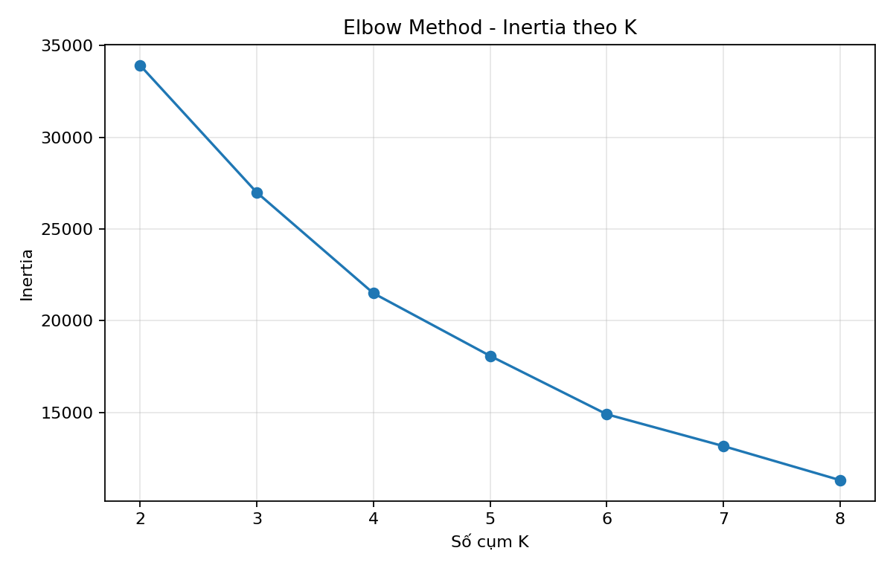

*Hình 7. Elbow Method: Inertia theo số cụm K.*


Inertia là tổng bình phương khoảng cách từ các điểm đến tâm cụm. Inertia
thường giảm khi K tăng, vì nhiều cụm hơn có thể làm các điểm gần tâm
hơn.

Elbow Method quan sát tốc độ giảm của Inertia theo K. Điểm khuỷu tay là
vị trí mà việc tăng K không còn làm Inertia giảm mạnh như trước.

Inertia không nên được sử dụng một mình để chọn K vì giá trị này có xu
hướng giảm khi tăng số cụm.

### 6.2. Silhouette Score

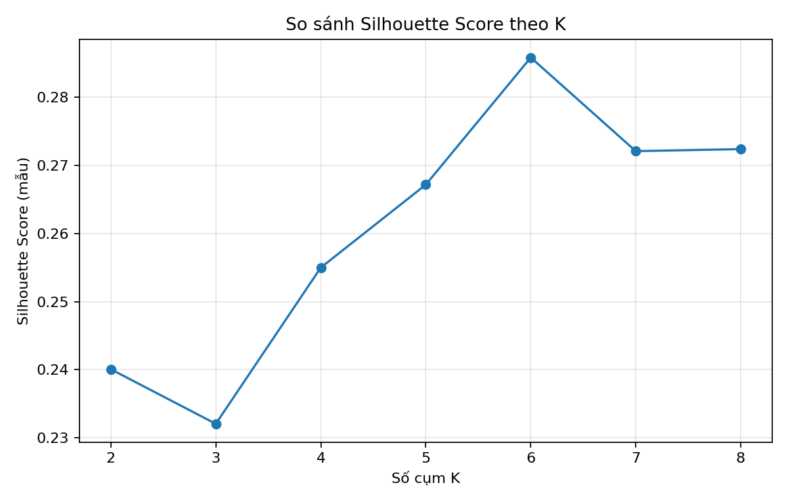

*Hình 8. Silhouette Score theo số cụm K.*


Silhouette Score đánh giá mức độ một điểm phù hợp với cụm hiện tại so
với cụm lân cận gần nhất:

\[ s(i)=`\frac{b(i)-a(i)}{\max(a(i),b(i))}`{=tex} \]

Trong đó: - (a(i)): khoảng cách trung bình từ điểm i đến các điểm cùng
cụm. - (b(i)): khoảng cách trung bình nhỏ nhất từ điểm i đến một cụm
khác.

Giá trị Silhouette nằm trong khoảng từ -1 đến 1: - Gần 1: điểm phù hợp
với cụm hiện tại và tách biệt tương đối tốt. - Gần 0: điểm nằm gần ranh
giới giữa các cụm. - Nhỏ hơn 0: điểm có thể được gán vào cụm chưa phù
hợp.

Do tính toán khoảng cách cặp đôi tốn chi phí, dự án ước lượng Silhouette
trên mẫu tối đa 1.000 điểm với `random_state=42`.

### 6.3. Các chỉ số bổ sung

Trong phần thực nghiệm mở rộng, dự án bổ sung:

-   **Calinski-Harabasz (CH):** so sánh độ phân tán giữa các cụm với độ
    phân tán bên trong cụm; thường càng cao càng tốt.
-   **Davies-Bouldin (DB):** đánh giá mức tương đồng giữa mỗi cụm với
    cụm gần nhất; thường càng thấp càng tốt.
-   **Inertia:** đánh giá mức độ thu gọn của các cụm; thường càng thấp
    càng tốt khi so sánh trong cùng bối cảnh K.

Không có một chỉ số đơn lẻ nào đủ để khẳng định chất lượng phân cụm. Cần
kết hợp nhiều chỉ số và kiểm tra hồ sơ cụm.

## 7. Kết quả thực nghiệm

### 7.1. Kết quả lựa chọn K

Trong lần thực nghiệm cập nhật, chương trình khảo sát K từ 2 đến 8. Kết
quả ghi nhận:

    K       Inertia   Silhouette Score (mẫu)
  --- ------------- ------------------------
    2   33.927,6926                   0,2401
    3   26.997,0444                   0,2320
    4   21.502,2601                   0,2550
    5   18.088,5254                   0,2672
    6   14.905,6510               **0,2859**
    7   13.170,8885                   0,2721
    8   11.315,0007                   0,2724

K=6 có Silhouette Score cao nhất trong phạm vi K đã thử, vì vậy được
chọn làm số cụm cho mô hình cơ sở.

Kết quả mô hình được ghi nhận: - Số khách hàng: **15.079**. - Số cụm
được chọn: **6**. - Inertia: **14.905,6510**. - Silhouette Score (mẫu
tối đa 1.000 điểm): **0,2859**.

Silhouette Score khoảng 0,286 cho thấy các cụm có mức phân biệt nhất
định nhưng chưa tách biệt mạnh. Vì vậy, cần kết hợp biểu đồ phân cụm,
kích thước cụm và hồ sơ đặc trưng để diễn giải. K=6 là lựa chọn tốt nhất
theo Silhouette trong phạm vi đã khảo sát, không phải kết luận tối ưu
tuyệt đối cho mọi cách biểu diễn dữ liệu.

### 7.2. Hồ sơ và kích thước cụm

**Trực quan hóa kết quả phân cụm**

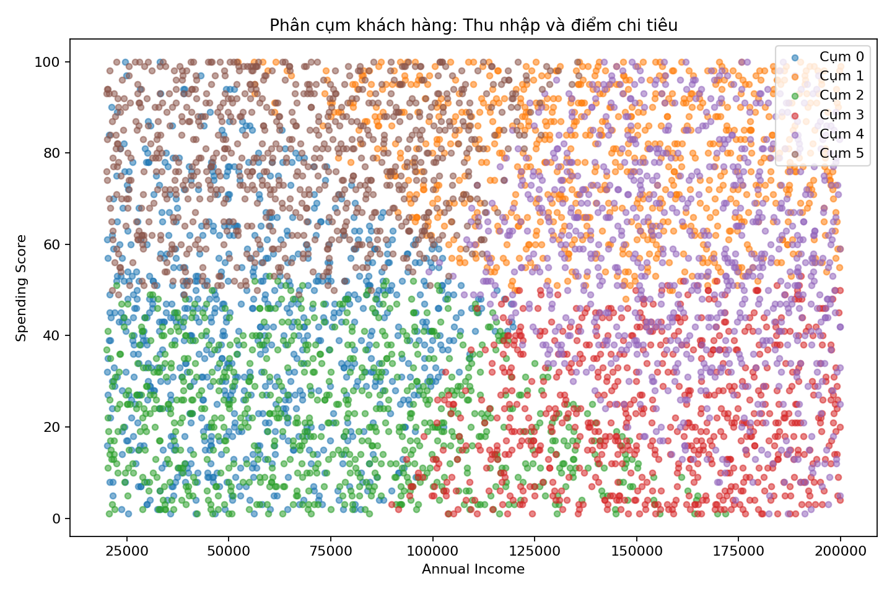

*Hình 9. Các cụm khách hàng theo Annual Income và Spending Score.*

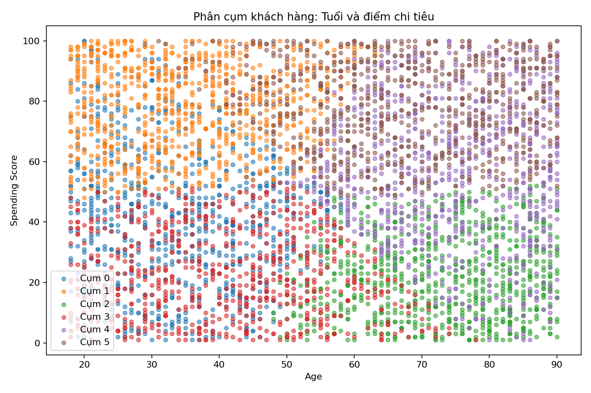

*Hình 10. Các cụm khách hàng theo Age và Spending Score.*

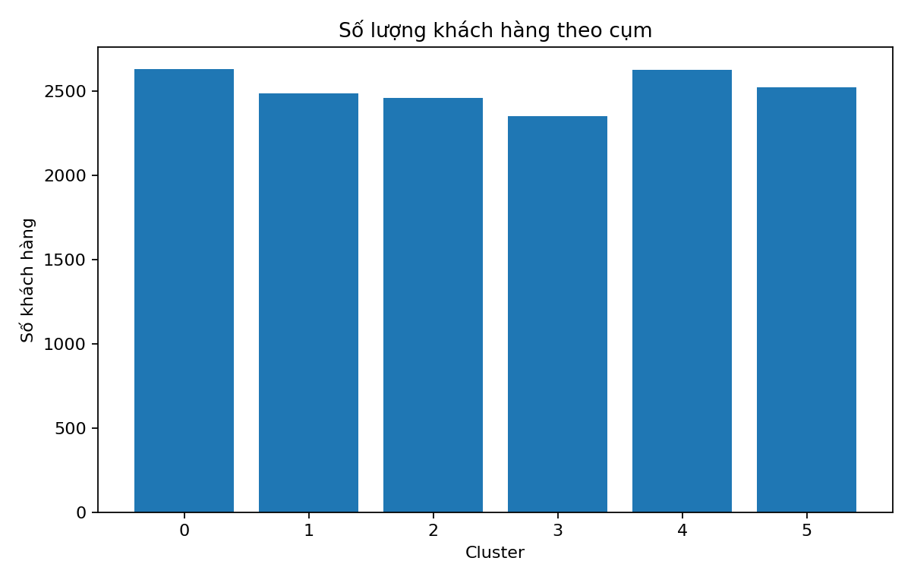

*Hình 11. Số lượng khách hàng trong từng cụm.*

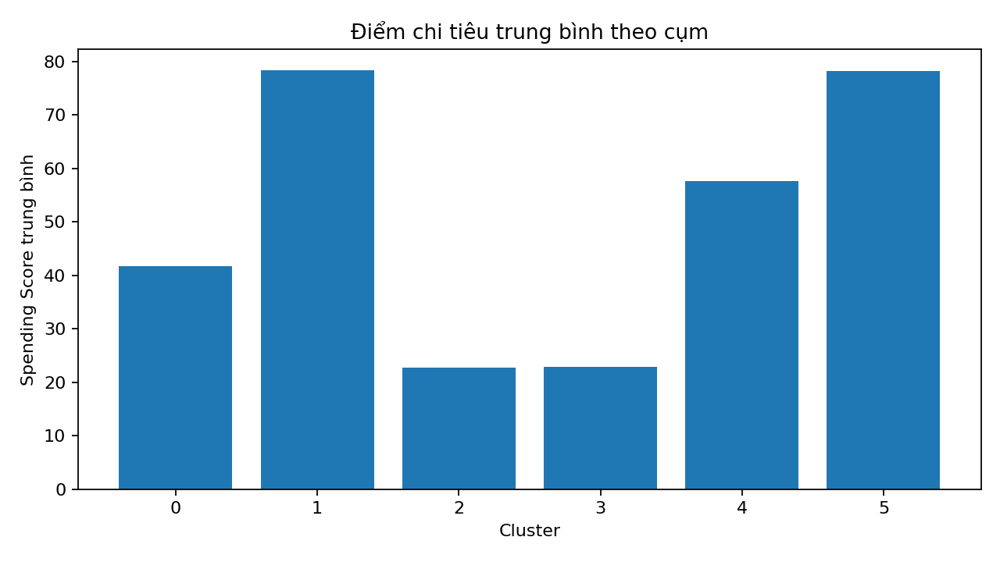

*Hình 12. Spending Score trung bình của từng cụm.*


Sau khi chọn mô hình, `src/evaluate.py` sử dụng `model.predict(X)` để
gán nhãn Cluster cho toàn bộ khách hàng.

Kết quả được lưu tại: - `data/processed/customer_clusters.csv`: dữ liệu
khách hàng kèm nhãn cụm. - `data/processed/cluster_profile.csv`: số
lượng, trung bình, trung vị các đặc trưng và tỷ lệ giới tính theo cụm.

Hồ sơ cụm được xây dựng từ: - Số lượng khách hàng trong từng cụm. - Tuổi
trung bình và trung vị. - Thu nhập trung bình và trung vị. - Spending
Score trung bình và trung vị. - Tỷ lệ Female/Male trong từng cụm.

Các nhãn Cluster 0, 1, 2,... chỉ là mã định danh do thuật toán tạo ra,
không thể hiện thứ hạng hay mức độ tốt/xấu của khách hàng. Tên mô tả cụm
cần được đặt sau khi xem xét các đặc trưng nổi bật trong
`cluster_profile.csv`.

**Lưu ý:** Kích thước cụm và hồ sơ cụm phải lấy từ
`customer_clusters.csv` và `cluster_profile.csv` của cùng một Run_ID/lần
chạy với các chỉ số K=6 đang trình bày. Không nên trộn hồ sơ của lần
chạy cũ với kết quả mô hình mới.

### 7.3. Biểu đồ đánh giá

Các biểu đồ chính được tạo trong quá trình EDA, Preprocessing và
Evaluation, bao gồm: - Phân phối Age, Annual Income và Spending Score. -
Boxplot và thống kê ngoại lệ. - Elbow Method --- Inertia theo K. -
Silhouette Score theo K. - Kích thước từng cụm. - Scatter plot phân cụm
theo Annual Income và Spending Score. - Scatter plot phân cụm theo Age
và Spending Score. - Spending Score trung bình theo cụm.

Hình ảnh được lưu trong `docs/images/` và được Figure Manager thu thập
theo từng lần chạy để đưa vào báo cáo.

## 8. Thực nghiệm mở rộng (Additional Experiments)

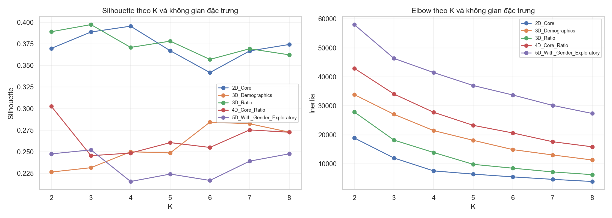

*Hình 13. So sánh kết quả giữa các không gian đặc trưng.*


Ngoài feature space cơ sở gồm ba đặc trưng Age, Annual Income và
Spending Score, dự án khảo sát các không gian đặc trưng khác nhau để
đánh giá ảnh hưởng của việc lựa chọn biến.

  ------------------------------------------------------------------------------
  Feature Space                  Đặc trưng               Mục đích
  ------------------------------ ----------------------- -----------------------
  `2D_Core`                      Annual Income, Spending Dễ trực quan hóa và đối
                                 Score                   chiếu phân khúc

  `3D_Demographics`              Age, Annual Income,     Không gian cơ sở của
                                 Spending Score          báo cáo

  `3D_Ratio`                     Annual Income, Spending Khảo sát giá trị của
                                 Score, Spending/Income  đặc trưng tỷ lệ

  `4D_Core_Ratio`                Age, Annual Income,     Đánh giá thêm đặc trưng
                                 Spending Score,         dẫn xuất
                                 Spending/Income         

  `5D_With_Gender_Exploratory`   Bốn đặc trưng trên và   Khảo sát ảnh hưởng của
                                 Gender mã hóa           biến phân loại
  ------------------------------------------------------------------------------

Mỗi feature space được chuẩn hóa độc lập trước khi tính khoảng cách.
`Customer ID` luôn bị loại khỏi đầu vào.

Một số lưu ý: - `Gender` được mã hóa thành 0/1 chỉ để khảo sát; khoảng
cách số học giữa hai mã không nhất thiết mang ý nghĩa tự nhiên. -
`Spending/Income` là đặc trưng dẫn xuất từ các biến đã có, có thể làm
tăng ảnh hưởng của thông tin tương tự. - Không gian nhiều chiều hơn
không mặc nhiên tạo ra kết quả phân cụm tốt hơn. - Kết quả cần được so
sánh bằng Silhouette, CH, DB, Inertia và khả năng diễn giải cụm.

### 8.1. Grid Search

Grid Search khảo sát nhiều tổ hợp tham số: - `K`: từ 2 đến 8. - `init`:
`random` và `k-means++`. - `max_iter`: 60 và 120. - `tol`: `1e-4`. -
Feature spaces: các không gian được khai báo trong `config.yaml`.

Silhouette được ước lượng trên mẫu tối đa 1.000 điểm để kiểm soát thời
gian. Calinski-Harabasz và Davies-Bouldin được tính để bổ sung góc nhìn
đánh giá.

Kết quả Grid Search được lưu tại
`data/processed/grid_search_results.csv`.

Dự án giữ thuật toán K-Means chuẩn với khoảng cách Euclidean và cập nhật
tâm bằng trung bình. Không sử dụng Manhattan kết hợp median trong
K-Means vì đó là biến thể K-medians, có hàm mục tiêu và quy tắc cập nhật
tâm khác.

## 9. Hội tụ và Inference

### 9.1. Convergence --- Theo dõi hội tụ

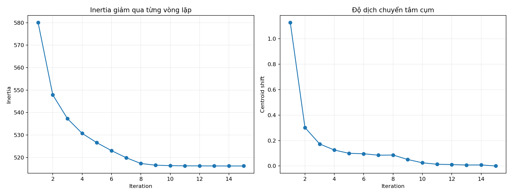

*Hình 14. Sự thay đổi Inertia và độ dịch chuyển tâm qua các vòng lặp.*


Lớp KMeans lưu `history_` sau mỗi vòng lặp, gồm: - `iteration`: số thứ
tự vòng lặp. - `inertia`: tổng bình phương khoảng cách trong cụm. -
`centroid_shift`: độ dịch chuyển của các tâm. - `cluster_sizes`: số điểm
thuộc mỗi cụm. - `centers`: tọa độ tâm cụm tại vòng lặp đó.

Module `src/demo_convergence.py` sử dụng lịch sử này để tạo biểu đồ hội
tụ và bảng lịch sử. Có thể chạy riêng:

``` bash
python -m src.demo_convergence
```

Kết quả chính: - `data/processed/convergence_history.csv` -
`docs/images/kmeans_convergence.png`

Biểu đồ giúp quan sát Inertia giảm như thế nào và độ dịch chuyển tâm
tiến dần về ngưỡng dừng. Đây là cách kiểm tra quá trình tối ưu, không
thay thế việc đánh giá chất lượng phân cụm.

### 9.2. Inference --- Dự đoán khách hàng mới

Module `src/predict.py` hỗ trợ gán một khách hàng mới vào cụm đã học.
Đầu vào gồm: - Age. - Annual Income. - Spending Score.

Quy trình: 1. Nạp `models/best_kmeans.pkl`. 2. Nạp thông tin chuẩn hóa
từ `data/processed/scaler.json`. 3. Kiểm tra dữ liệu đầu vào. 4. Chuẩn
hóa ba đặc trưng bằng đúng mean và standard deviation của dữ liệu huấn
luyện. 5. Gọi `model.predict()` để xác định cụm gần nhất. 6. Trả về
Cluster, đặc trưng đã chuẩn hóa và thời gian dự đoán. 7. Ghi kết quả vào
`reports/inference_history.csv`.

Không được tính lại mean và standard deviation từ riêng khách hàng mới,
vì phải sử dụng scaler của dữ liệu huấn luyện để bảo đảm cùng hệ quy
chiếu.

Chạy inference bằng terminal:

``` bash
python -m src.predict
```

Chạy giao diện Streamlit:

``` bash
python -m streamlit run app.py
```

## 10. Tracking, Logging và Report Generation

### 10.1. Run_ID và Progress Tracking

Mỗi lần Pipeline chạy tạo một `Run_ID` riêng. Run_ID được sử dụng để
liên kết trạng thái, thời gian thực thi, kết quả các Stage, hình ảnh và
báo cáo của cùng một lần chạy.

`src/tracking.py` quản lý: - Tạo Run_ID. - Khởi tạo Progress JSON. - Cập
nhật trạng thái từng Stage. - Ghi nhận input, output và lỗi. - Ghi thời
gian thực thi. - Kết thúc Run với trạng thái SUCCESS hoặc FAILED.

Progress JSON được lưu trong `progress_results/`.

### 10.2. Logging

Log ghi lại các sự kiện theo thời gian, bao gồm: - Thời điểm bắt đầu
Stage. - Stage hoàn thành. - Thời gian xử lý. - Lỗi phát sinh. - Trạng
thái cuối của Pipeline.

Nhật ký được lưu trong `logs/`. Progress JSON lưu dữ liệu có cấu trúc để
máy có thể đọc và tổng hợp; Log là nhật ký văn bản để người phát triển
kiểm tra quá trình chạy.

### 10.3. Figure Management

`src/figure_manager.py` thu thập các ảnh được tạo trong `docs/images/`,
nhận diện Stage và tổ chức ảnh theo Pipeline/Run_ID. Các nhóm ảnh gồm
EDA, Preprocessing, Training, Evaluation, Experiments, Convergence và
nhóm khác tùy tên file được nhận diện.

Kết quả được đưa vào `reports/figures/` để Report Generator sử dụng.

### 10.4. Report Generation

`src/report.py` đọc Progress JSON, Log, dữ liệu đã xử lý, kết quả thực
nghiệm, nhãn cụm, hồ sơ cụm và hình ảnh. Sau đó tạo ba định dạng: -
`reports/report_<Run_ID>.md` - `reports/report_<Run_ID>.html` -
`reports/report_<Run_ID>.pdf`

Trong Pipeline hiện tại, Report Generation là một Stage được gọi sau
Visualization. Ngoài ra, có thể tạo lại báo cáo riêng cho một Run_ID:

``` bash
python -m src.report --run-id <RUN_ID>
```

### 10.5. Lịch sử thực nghiệm và Inference

-   `docs/experiment_logs.csv`: lưu lịch sử thử nghiệm K, Timestamp và
    Run_ID.
-   `reports/metrics_summary.csv`: lưu bảng tổng hợp metric theo Run_ID
    nếu được cập nhật bởi phiên bản mã nguồn tương ứng.
-   `reports/inference_history.csv`: lưu lịch sử dự đoán khách hàng mới.

Không nhầm lẫn ba loại dữ liệu: Experiment Log ghi lịch sử thử nghiệm
tham số; Progress/Log theo dõi Pipeline; Inference History ghi các lần
dự đoán dữ liệu mới.

## 11. Cấu trúc kết quả

``` text
Lab03_ML/
│
├── data/
│   ├── raw/
│   │   └── customer_segmentation.csv
│   └── processed/
│       ├── customers_clean.csv
│       ├── X_scaled.csv
│       ├── scaler.json
│       ├── experiment_results.csv
│       ├── grid_search_results.csv
│       ├── customer_clusters.csv
│       ├── cluster_profile.csv
│       └── convergence_history.csv
│
├── models/
│   └── best_kmeans.pkl
│
├── docs/
│   ├── images/
│   ├── experiment_logs.csv
│   └── results_summary.md
│
├── progress_results/
│   └── progress_<Run_ID>.json
│
├── logs/
│   └── pipeline_<Run_ID>.log
│
└── reports/
    ├── figures/
    │   └── <Run_ID>/
    │       ├── eda/
    │       ├── preprocessing/
    │       ├── training/
    │       ├── evaluation/
    │       ├── experiments/
    │       └── convergence/
    ├── report_<Run_ID>.md
    ├── report_<Run_ID>.html
    ├── report_<Run_ID>.pdf
    ├── metrics_summary.csv
    └── inference_history.csv
```

Tên và vị trí một số thư mục con có thể thay đổi theo cấu hình hoặc
phiên bản mã nguồn; cần đối chiếu với kết quả thực tế sau khi chạy
Pipeline.

## 12. Cách cài đặt và chạy

Thực hiện lệnh tại thư mục gốc `Lab03_ML`.

### 12.1. Tạo môi trường ảo

``` powershell
python -m venv .venv
.\.venv\Scripts\Activate.ps1
```

### 12.2. Cài đặt thư viện

``` bash
python -m pip install --upgrade pip
pip install -r requirements.txt
```

### 12.3. Chạy Pipeline cơ bản

``` bash
python -m src.pipeline
```

Pipeline cơ bản thực hiện: 1. EDA. 2. Preprocessing. 3. Training. 4.
Evaluation. 5. Visualization. 6. Report Generation.

### 12.4. Chạy Pipeline mở rộng

``` bash
python -m src.pipeline --extended
```

Ngoài các giai đoạn cơ bản, tùy chọn `--extended` bổ sung: -
Experiments: so sánh feature spaces và Grid Search. - Convergence: lưu
lịch sử và biểu đồ hội tụ.

### 12.5. Chạy riêng từng giai đoạn

``` bash
python -m src.eda
python -m src.preprocess
python -m src.train
python -m src.evaluate
python -m src.experiments
python -m src.demo_convergence
```

Các giai đoạn riêng cần được chạy đúng thứ tự và bảo đảm dữ liệu đầu vào
của giai đoạn trước đã tồn tại.

### 12.6. Kiểm thử

``` bash
python -m unittest discover -s tests -v
```

## 13. Hạn chế và hướng phát triển

1.  **Mức độ tách biệt cụm:** Silhouette Score hiện tại chưa cao, cho
    thấy ranh giới giữa một số cụm chưa thật sự rõ. Có thể khảo sát thêm
    K hoặc thuật toán phân cụm khác.
2.  **Phụ thuộc vào đặc trưng:** Kết quả K-Means nhạy với feature space
    và cách chuẩn hóa. Cần đánh giá cẩn thận trước khi thêm biến dẫn
    xuất hoặc biến phân loại.
3.  **Khởi tạo tâm:** K-means++ giúp cải thiện khởi tạo, nhưng kết quả
    vẫn có thể thay đổi theo random_state. Có thể chạy nhiều lần khởi
    tạo để đánh giá độ ổn định.
4.  **Ngoại lệ:** K-Means sử dụng trung bình và bình phương khoảng cách
    nên nhạy với giá trị ngoại lệ. Cần xem xét ảnh hưởng của các điểm
    cực đoan thay vì xóa tự động.
5.  **Diễn giải cụm:** Cluster chỉ là nhãn định danh. Cần dựa trên
    cluster profile và kiến thức nghiệp vụ để đặt tên và giải thích.
6.  **Đánh giá mở rộng:** Có thể so sánh K-Means với các phương pháp
    khác như Hierarchical Clustering hoặc DBSCAN nếu phạm vi bài học cho
    phép.
7.  **Tái lập thực nghiệm:** Cần lưu Run_ID, cấu hình, phiên bản thư
    viện và kết quả của từng lần chạy để đối chiếu chính xác.
8.  **Inference:** Cần bảo đảm scaler và model luôn thuộc cùng một lần
    huấn luyện; dữ liệu đầu vào phải tuân thủ cùng định nghĩa và thứ tự
    đặc trưng.

## 14. Kết luận

Lab03 đã xây dựng quy trình phân cụm khách hàng từ dữ liệu ban đầu đến
khám phá dữ liệu, làm sạch, lựa chọn đặc trưng, chuẩn hóa, huấn luyện
K-Means, đánh giá và dự đoán cụm cho khách hàng mới.

Thuật toán K-Means được tự cài đặt bằng NumPy với hai cách khởi tạo tâm
Random và K-means++, cơ chế xử lý cụm rỗng, điều kiện dừng theo độ dịch
chuyển tâm và lưu lịch sử hội tụ. Mô hình cơ sở sử dụng ba đặc trưng
`Age`, `Annual Income` và `Spending Score`; `Customer ID` không được đưa
vào tính khoảng cách, còn `Gender` được giữ lại để mô tả cụm.

Trong phạm vi khảo sát K từ 2 đến 8, lần thực nghiệm cập nhật chọn
**K=6**, đạt Inertia **14.905,6510** và Silhouette Score mẫu **0,2859**.
Đây là cấu hình có Silhouette Score cao nhất trong các giá trị K đã thử,
nhưng mức điểm cho thấy các cụm chưa tách biệt mạnh. Do đó, cần kết hợp
các chỉ số đánh giá, biểu đồ và hồ sơ cụm để diễn giải kết quả một cách
thận trọng.

Phần thực nghiệm mở rộng khảo sát nhiều feature spaces, Grid Search và
quá trình hội tụ. Hệ thống cũng tích hợp Tracking, Logging, Figure
Management và Report Generation để theo dõi từng lần chạy, lưu kết quả
và tạo báo cáo MD/HTML/PDF. Chức năng Inference cho phép sử dụng model
cùng scaler đã lưu để phân cụm khách hàng mới.

Nhìn chung, dự án đáp ứng mục tiêu thực hành K-Means và xây dựng một quy
trình phân cụm có thể tái lập, theo dõi và mở rộng. Kết quả K=6 là lựa
chọn phù hợp theo tiêu chí Silhouette trong phạm vi thực nghiệm hiện
tại, không phải kết luận tối ưu tuyệt đối cho mọi dữ liệu hoặc ứng dụng
thực tế.
