# BÁO CÁO ĐỒ ÁN MACHINE LEARNING

# ADDITIONAL: IMAGE SEGMENTATION USING K-MEANS

## THÔNG TIN THỰC NGHIỆM

- **Run_ID:** `additional_image_segmentation--20261111_210744_bbfbcd`
- **Trạng thái:** SUCCESS
- **Thời gian tạo:** 2026-11-11 21:21:23 SE Asia Standard Time
- **Phương pháp:** K-Means với K-Means++ initialization
- **Đặc trưng:** RGB color space
- **Đơn vị dữ liệu:** Pixel

## 1. GIỚI THIỆU

### 1.1. Bối cảnh bài toán

Image Segmentation là quá trình phân chia ảnh thành các nhóm pixel có đặc điểm tương đồng. Trong bài thực nghiệm này, phân cụm được thực hiện dựa trên màu sắc RGB của pixel.

K-Means là thuật toán học không giám sát, không yêu cầu nhãn phân đoạn có sẵn. Thuật toán tìm các tâm cụm sao cho tổng bình phương khoảng cách giữa pixel và tâm cụm tương ứng được tối thiểu hóa.

### 1.2. Mục tiêu

- Xây dựng thuật toán K-Means từ đầu.
- Sử dụng K-Means++ để khởi tạo tâm cụm.
- Khảo sát ảnh hưởng của số cụm K.
- Trực quan hóa kết quả phân đoạn.
- Phân tích màu đại diện và tỷ lệ pixel của từng cụm.

### 1.3. Phạm vi thực nghiệm

Thực nghiệm sử dụng ảnh RGB. Mỗi pixel được biểu diễn bằng vector ba chiều gồm giá trị Red, Green và Blue. Thuật toán không sử dụng vị trí không gian hoặc đặc trưng ngữ nghĩa.

## 2. DỮ LIỆU ĐẦU VÀO

### 2.1. Danh sách ảnh

| Image | Height | Width | Total pixels | Tested K |
| --- | --- | --- | --- | --- |
| image1.jpg | 0 | 0 | 0 |  |
| image2.jpg | 0 | 0 | 0 |  |

### 2.2. Cấu trúc dữ liệu ảnh

Ảnh được đọc và chuyển sang RGB để đảm bảo mỗi pixel có ba kênh màu. Ảnh có kích thước H × W × 3 được chuyển thành ma trận N × 3, với N = H × W.

Mỗi hàng của ma trận tương ứng với một pixel. Ba cột lần lượt là giá trị Red, Green và Blue.

### 2.3. Đặc điểm dữ liệu

- Số lượng mẫu phụ thuộc vào độ phân giải của ảnh.
- Các giá trị RGB nằm trong khoảng 0 đến 255.
- Pixel trong cùng một vùng ảnh có thể có màu gần nhau.
- Các vùng vật thể khác nhau có thể có màu tương tự.

## 3. TIỀN XỬ LÝ DỮ LIỆU

### 3.1. Đọc và chuẩn hóa định dạng ảnh

Ảnh đầu vào được đọc bằng Pillow và chuyển về RGB. Bước này giúp thống nhất số kênh màu, tránh trường hợp ảnh đầu vào sử dụng grayscale, RGBA hoặc các định dạng màu khác.

### 3.2. Chuyển ảnh thành ma trận pixel

Ma trận ảnh ba chiều được reshape thành ma trận hai chiều. Dữ liệu được chuyển sang float32 để thực hiện phép tính khoảng cách và cập nhật tâm cụm.

### 3.3. Lấy mẫu pixel

Với ảnh có độ phân giải lớn, việc huấn luyện trên toàn bộ pixel có thể làm tăng chi phí tính toán. Pipeline sử dụng lấy mẫu ngẫu nhiên không hoàn lại để tạo tập pixel huấn luyện.

Sau khi huấn luyện, mô hình dự đoán nhãn cho toàn bộ pixel theo từng batch để hạn chế sử dụng bộ nhớ.

### 3.4. Tái tạo ảnh

Sau khi xác định nhãn cụm của từng pixel, mỗi pixel được thay bằng màu RGB của tâm cụm tương ứng. Ma trận pixel được reshape về kích thước ảnh ban đầu.

## 4. PHƯƠNG PHÁP

### 4.1. K-Means

K-Means tối ưu tổng bình phương khoảng cách trong mỗi cụm:

$$J = \\sum_{i=1}^{N} \\left\\|x_i - \\mu_{c_i}\\right\\|^2$$

Trong đó:
- $x_i$: vector RGB của pixel thứ i.
- $\\mu_{c_i}$: tâm cụm được gán cho pixel.
- $N$: tổng số pixel.
- $c_i$: nhãn cụm của pixel.

### 4.2. Khởi tạo K-Means++

K-Means++ lựa chọn tâm đầu tiên ngẫu nhiên. Các tâm tiếp theo được chọn dựa trên xác suất tỷ lệ với bình phương khoảng cách đến tâm gần nhất đã chọn.

Cách khởi tạo này giúp các tâm ban đầu phân bố hợp lý hơn so với việc chọn hoàn toàn ngẫu nhiên.

### 4.3. Gán cụm

Mỗi pixel được gán vào tâm cụm có khoảng cách Euclidean nhỏ nhất trong không gian RGB.

$$c_i = \\arg\\min_k \\left\\|x_i - \\mu_k\\right\\|^2$$

### 4.4. Cập nhật tâm cụm

Tâm cụm được cập nhật bằng trung bình cộng của tất cả pixel thuộc cụm đó.

$$\\mu_k = \\frac{1}{|C_k|}\\sum_{x_i \\in C_k} x_i$$

### 4.5. Điều kiện dừng

Thuật toán dừng khi độ dịch chuyển tâm cụm nhỏ hơn ngưỡng tolerance hoặc đạt số vòng lặp tối đa.

## 5. THIẾT LẬP THỰC NGHIỆM

### 5.1. Cấu hình

- **Các giá trị K khảo sát Elbow:** `[2, 3, 4, 5, 6, 8]`
- **Các giá trị K phân đoạn:** `[3, 5, 8]`
- **Khởi tạo:** K-Means++
- **Random state:** 42
- **Số vòng lặp tối đa:** 100
- **Số pixel huấn luyện tối đa:** 20.000
- **Kênh màu:** RGB

### 5.2. Quy trình thực nghiệm

1. Đọc ảnh và chuyển sang RGB.
2. Chuyển ảnh thành ma trận pixel.
3. Lấy mẫu pixel để huấn luyện.
4. Chạy Elbow Method trên nhiều giá trị K.
5. Huấn luyện mô hình với các giá trị K phân đoạn.
6. Dự đoán nhãn cho toàn bộ pixel.
7. Tái tạo ảnh và lưu kết quả.
8. Thống kê màu đại diện và trực quan hóa.

## 6. KẾT QUẢ ELBOW METHOD

### 6.1. Bảng kết quả

| image | K | inertia | n_iter | n_samples |
| --- | --- | --- | --- | --- |
| image1.jpg | 2 | 109355892.046 | 9 | 20000 |
| image1.jpg | 3 | 79174042.863 | 14 | 20000 |
| image1.jpg | 4 | 47806097.302 | 22 | 20000 |
| image1.jpg | 5 | 37672660.463 | 49 | 20000 |
| image1.jpg | 6 | 32308069.583 | 34 | 20000 |
| image1.jpg | 8 | 23773452.379 | 43 | 20000 |
| image2.jpg | 2 | 100656129.382 | 14 | 20000 |
| image2.jpg | 3 | 71356956.533 | 29 | 20000 |
| image2.jpg | 4 | 58851242.914 | 22 | 20000 |
| image2.jpg | 5 | 47601012.721 | 46 | 20000 |
| image2.jpg | 6 | 42264828.606 | 38 | 20000 |
| image2.jpg | 8 | 34100663.53 | 82 | 20000 |

### 6.2. Biểu đồ Elbow

### 6.3. Nhận xét

- Với ảnh **image1.jpg**, Inertia giảm khoảng **78.26%** trong phạm vi K được thử nghiệm.
- Mức giảm Inertia có xu hướng chậm lại sau vùng K xấp xỉ **4**. Đây chỉ là gợi ý tham khảo, không phải K tối ưu được xác định chắc chắn.
- Với ảnh **image2.jpg**, Inertia giảm khoảng **66.12%** trong phạm vi K được thử nghiệm.
- Mức giảm Inertia có xu hướng chậm lại sau vùng K xấp xỉ **3**. Đây chỉ là gợi ý tham khảo, không phải K tối ưu được xác định chắc chắn.

Elbow Method cung cấp thông tin về mức giảm Inertia khi tăng K. Tuy nhiên, điểm gấp khúc có thể không rõ ràng đối với một số ảnh. Do đó, cần kết hợp quan sát trực quan để lựa chọn số cụm phù hợp.

## 7. KẾT QUẢ IMAGE SEGMENTATION

### 7.1. Ảnh: image1.jpg

#### So sánh ảnh gốc và ảnh phân đoạn

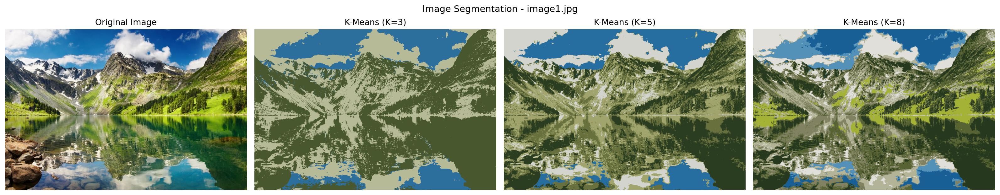

#### Kết quả theo từng K

**K = 3**

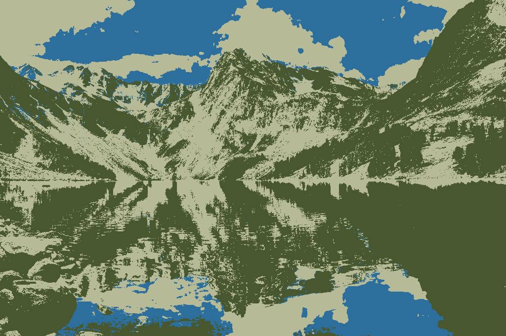

**K = 5**

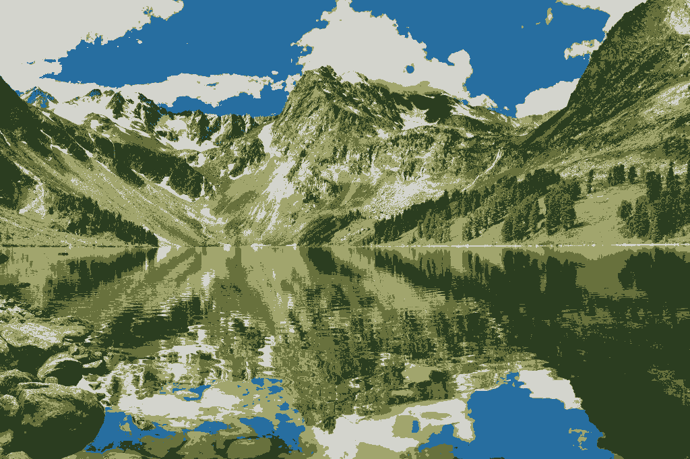

**K = 8**

#### Nhận xét

K nhỏ thường làm ảnh có ít màu đại diện hơn, giúp đơn giản hóa màu sắc nhưng có thể làm mất các chi tiết màu nhỏ.

K lớn giữ được nhiều sắc thái màu hơn. Tuy nhiên, việc tăng K không đồng nghĩa với việc ranh giới đối tượng trong ảnh được nhận diện chính xác hơn.

### 7.2. Ảnh: image2.jpg

#### So sánh ảnh gốc và ảnh phân đoạn

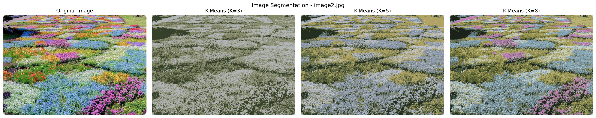

#### Kết quả theo từng K

**K = 3**

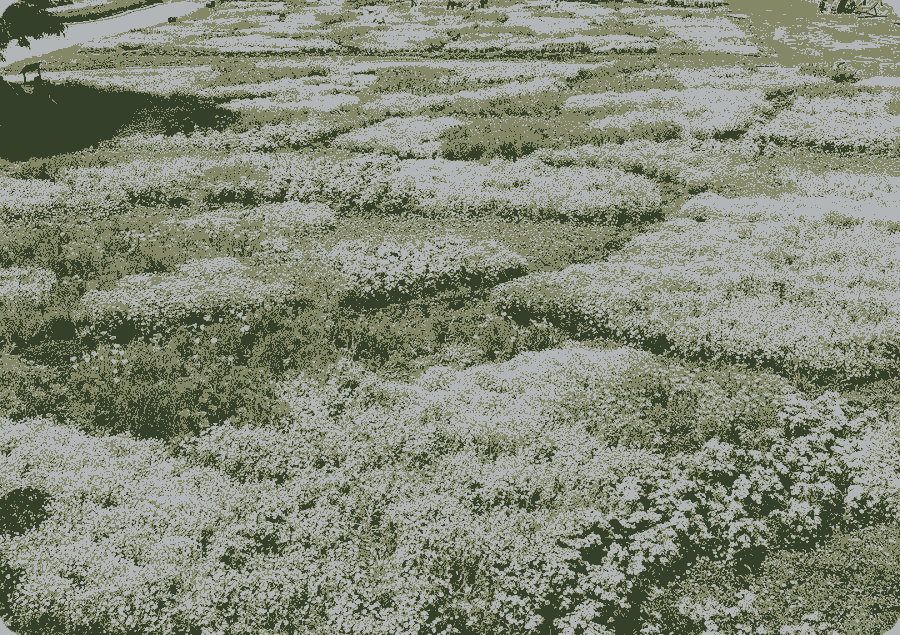

**K = 5**

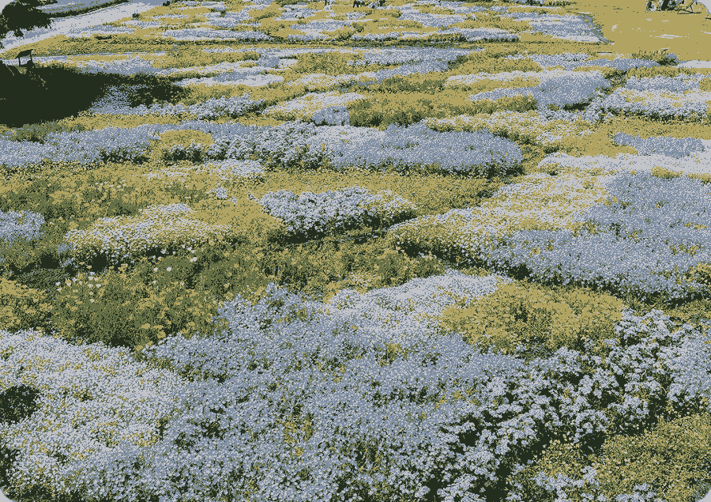

**K = 8**

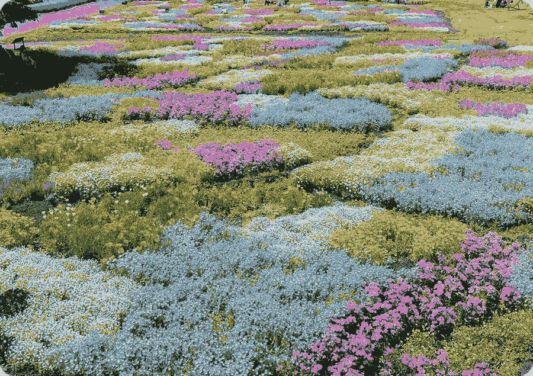

#### Nhận xét

K nhỏ thường làm ảnh có ít màu đại diện hơn, giúp đơn giản hóa màu sắc nhưng có thể làm mất các chi tiết màu nhỏ.

K lớn giữ được nhiều sắc thái màu hơn. Tuy nhiên, việc tăng K không đồng nghĩa với việc ranh giới đối tượng trong ảnh được nhận diện chính xác hơn.

## 8. PHÂN TÍCH BẢNG MÀU

### 8.1. Bảng màu RGB

| image | K | cluster | red | green | blue | pixel_count | proportion_percent |
| --- | --- | --- | --- | --- | --- | --- | --- |
| image1.jpg | 3 | 0 | 183.55 | 186.43 | 151.33 | 240228 | 34.45 |
| image1.jpg | 3 | 1 | 72.82 | 87.01 | 45.32 | 346398 | 49.67 |
| image1.jpg | 3 | 2 | 44.35 | 110.42 | 156.7 | 110718 | 15.88 |
| image1.jpg | 5 | 0 | 104.42 | 113.84 | 61.3 | 163432 | 23.44 |
| image1.jpg | 5 | 1 | 43.36 | 61.87 | 32.73 | 183486 | 26.31 |
| image1.jpg | 5 | 2 | 161.31 | 165.6 | 109.34 | 145873 | 20.92 |
| image1.jpg | 5 | 3 | 39.14 | 110.04 | 160.11 | 101492 | 14.55 |
| image1.jpg | 5 | 4 | 211.48 | 212.65 | 205.6 | 103061 | 14.78 |
| image1.jpg | 8 | 0 | 164.67 | 179.17 | 54.11 | 50487 | 7.24 |
| image1.jpg | 8 | 1 | 87.95 | 99.98 | 50.06 | 133729 | 19.18 |
| image1.jpg | 8 | 2 | 128.68 | 130.9 | 97.3 | 99155 | 14.22 |
| image1.jpg | 8 | 3 | 83.48 | 145.88 | 185.55 | 39970 | 5.73 |
| image1.jpg | 8 | 4 | 224.14 | 223.55 | 218.22 | 69186 | 9.92 |
| image1.jpg | 8 | 5 | 179.42 | 179.04 | 152.0 | 85679 | 12.29 |
| image1.jpg | 8 | 6 | 23.2 | 95.62 | 149.27 | 69178 | 9.92 |
| image1.jpg | 8 | 7 | 38.06 | 57.47 | 30.32 | 149960 | 21.5 |
| image2.jpg | 3 | 0 | 133.84 | 136.41 | 102.56 | 238663 | 41.76 |
| image2.jpg | 3 | 1 | 52.57 | 64.27 | 41.04 | 126627 | 22.16 |
| image2.jpg | 3 | 2 | 179.37 | 182.82 | 184.91 | 206210 | 36.08 |
| image2.jpg | 5 | 0 | 102.72 | 112.41 | 71.49 | 136329 | 23.85 |
| image2.jpg | 5 | 1 | 36.38 | 46.6 | 31.83 | 79439 | 13.9 |
| image2.jpg | 5 | 2 | 195.42 | 196.54 | 200.03 | 116857 | 20.45 |
| image2.jpg | 5 | 3 | 177.41 | 164.01 | 99.83 | 107701 | 18.85 |
| image2.jpg | 5 | 4 | 128.87 | 143.87 | 163.68 | 131174 | 22.95 |
| image2.jpg | 8 | 0 | 192.38 | 123.93 | 178.34 | 41891 | 7.33 |
| image2.jpg | 8 | 1 | 26.09 | 34.04 | 25.68 | 55365 | 9.69 |
| image2.jpg | 8 | 2 | 185.65 | 177.23 | 116.75 | 81021 | 14.18 |
| image2.jpg | 8 | 3 | 141.68 | 137.75 | 68.69 | 80972 | 14.17 |
| image2.jpg | 8 | 4 | 205.35 | 214.57 | 208.54 | 65282 | 11.42 |
| image2.jpg | 8 | 5 | 103.75 | 122.24 | 130.73 | 80677 | 14.12 |
| image2.jpg | 8 | 6 | 79.12 | 93.36 | 53.29 | 83609 | 14.63 |
| image2.jpg | 8 | 7 | 137.01 | 170.37 | 185.47 | 82683 | 14.47 |

### 8.2. Biểu đồ tỷ lệ màu

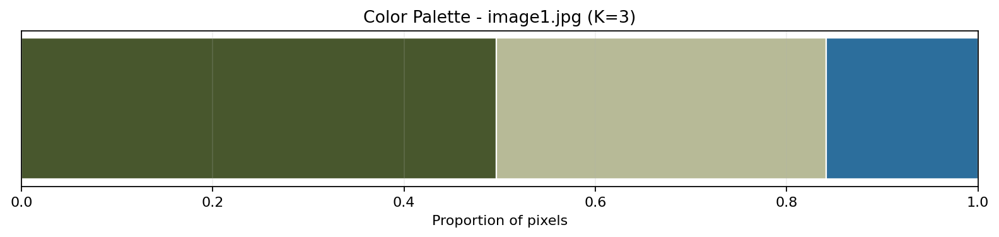

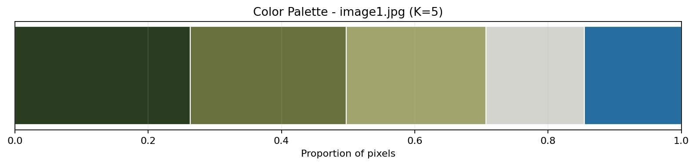

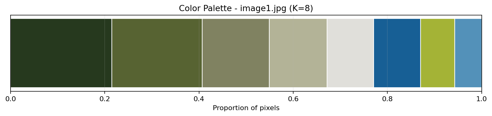

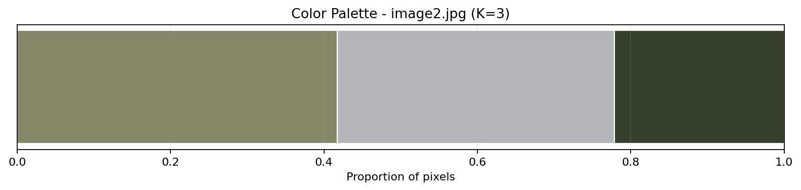

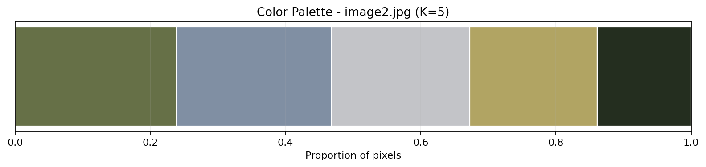

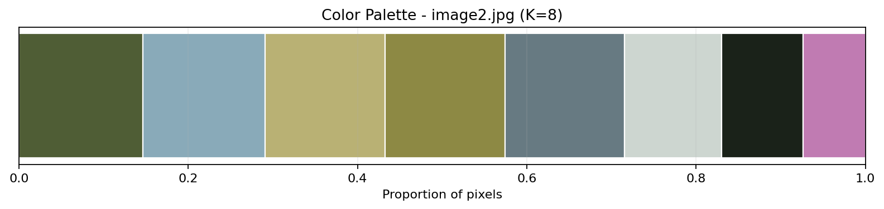

### 8.3. Nhận xét về phân bố màu

- Ảnh **image1.jpg**, K=3: cụm chiếm tỷ lệ lớn nhất là cluster 1, chiếm **49.67%** tổng số pixel.
  Cụm có tỷ lệ nhỏ nhất là cluster 2, chiếm **15.88%**.
- Ảnh **image1.jpg**, K=5: cụm chiếm tỷ lệ lớn nhất là cluster 1, chiếm **26.31%** tổng số pixel.
  Cụm có tỷ lệ nhỏ nhất là cluster 3, chiếm **14.55%**.
- Ảnh **image1.jpg**, K=8: cụm chiếm tỷ lệ lớn nhất là cluster 7, chiếm **21.50%** tổng số pixel.
  Cụm có tỷ lệ nhỏ nhất là cluster 3, chiếm **5.73%**.
- Ảnh **image2.jpg**, K=3: cụm chiếm tỷ lệ lớn nhất là cluster 0, chiếm **41.76%** tổng số pixel.
  Cụm có tỷ lệ nhỏ nhất là cluster 1, chiếm **22.16%**.
- Ảnh **image2.jpg**, K=5: cụm chiếm tỷ lệ lớn nhất là cluster 0, chiếm **23.85%** tổng số pixel.
  Cụm có tỷ lệ nhỏ nhất là cluster 1, chiếm **13.90%**.
- Ảnh **image2.jpg**, K=8: cụm chiếm tỷ lệ lớn nhất là cluster 6, chiếm **14.63%** tổng số pixel.
  Cụm có tỷ lệ nhỏ nhất là cluster 0, chiếm **7.33%**.

## 9. ĐÁNH GIÁ KẾT QUẢ

### 9.1. Khả năng giảm số lượng màu

K-Means thay thế các màu RGB ban đầu bằng một tập hợp màu đại diện có số lượng giới hạn. Khi K nhỏ, mức độ lượng tử hóa màu mạnh hơn. Khi K lớn, ảnh giữ lại nhiều sắc thái màu hơn.

### 9.2. Khả năng bảo toàn chi tiết

Các vùng có màu sắc tương đồng có thể được biểu diễn bằng cùng một tâm cụm. Điều này có thể làm mất những khác biệt màu sắc nhỏ giữa các vùng ảnh.

### 9.3. Đánh giá bằng Inertia

Inertia phản ánh mức độ gần nhau của pixel và tâm cụm trong không gian RGB. Inertia thấp hơn cho thấy các pixel gần tâm cụm hơn trên tập dữ liệu được đánh giá.

Do Inertia thường giảm khi tăng K, chỉ số này cần được xem xét cùng số lượng cụm và kết quả trực quan.

### 9.4. Đánh giá trực quan

Ảnh so sánh và biểu đồ bảng màu giúp đánh giá mức độ thay đổi màu sắc, sự xuất hiện của các cụm lớn và nhỏ, cũng như mức độ giữ lại chi tiết khi thay đổi K.

## 10. HẠN CHẾ

### 10.1. Chỉ sử dụng thông tin màu RGB

Thuật toán không sử dụng tọa độ pixel, kết cấu hoặc đặc trưng hình dạng. Vì vậy, các vùng ảnh không liên quan nhưng có màu gần nhau có thể bị gom vào cùng cụm.

### 10.2. Không hiểu ngữ nghĩa đối tượng

K-Means không biết đâu là người, cây, bầu trời, tòa nhà hay vật thể. Kết quả là phân cụm màu chứ không phải phân đoạn ngữ nghĩa.

### 10.3. Phụ thuộc vào số cụm K

K cần được lựa chọn trước. Một giá trị K không phù hợp có thể làm ảnh quá đơn giản hoặc vẫn giữ quá nhiều màu.

### 10.4. Ảnh hưởng của lấy mẫu

Mô hình được huấn luyện trên tập pixel lấy mẫu. Nếu mẫu không đại diện tốt cho phân bố màu của ảnh, tâm cụm có thể không phản ánh đầy đủ màu sắc trong ảnh.

## 11. HƯỚNG PHÁT TRIỂN

- Thử nghiệm không gian màu Lab để biểu diễn khác biệt màu sắc gần với cảm nhận thị giác hơn.
- Kết hợp tọa độ không gian của pixel với đặc trưng màu.
- Thử nghiệm các thuật toán phân đoạn khác như Mean Shift, DBSCAN hoặc Gaussian Mixture Model.
- Sử dụng phương pháp đánh giá bổ sung và so sánh trực quan giữa các cấu hình.
- Tối ưu hóa việc lấy mẫu và xử lý batch cho ảnh độ phân giải lớn.

## 12. KẾT LUẬN

Pipeline đã xây dựng quy trình phân đoạn ảnh bằng K-Means từ bước đọc ảnh, chuyển đổi dữ liệu pixel, lấy mẫu, huấn luyện, dự đoán đến tái tạo và trực quan hóa kết quả.

Elbow Method hỗ trợ khảo sát mối quan hệ giữa số cụm K và Inertia. Bảng màu giúp giải thích màu đại diện và tỷ lệ pixel của từng cụm. Ảnh so sánh giúp quan sát mức độ thay đổi khi điều chỉnh K.

K-Means phù hợp với mục tiêu lượng tử hóa màu và phân cụm pixel theo màu sắc. Tuy nhiên, phương pháp không thể thay thế các mô hình phân đoạn có khả năng nhận diện cấu trúc và ngữ nghĩa đối tượng.

## 13. CẤU TRÚC KẾT QUẢ

### 13.1. Hình ảnh và dữ liệu

`reports/figures/additional_image_segmentation/20261111_210744_bbfbcd/`

### 13.2. Báo cáo

- `image_segmentation_report.md`
- `image_segmentation_report.html`
- `image_segmentation_report.pdf`

---

_Báo cáo được tạo tự động bởi Additional Image Segmentation Pipeline. Run_ID: `additional_image_segmentation--20261111_210744_bbfbcd`._